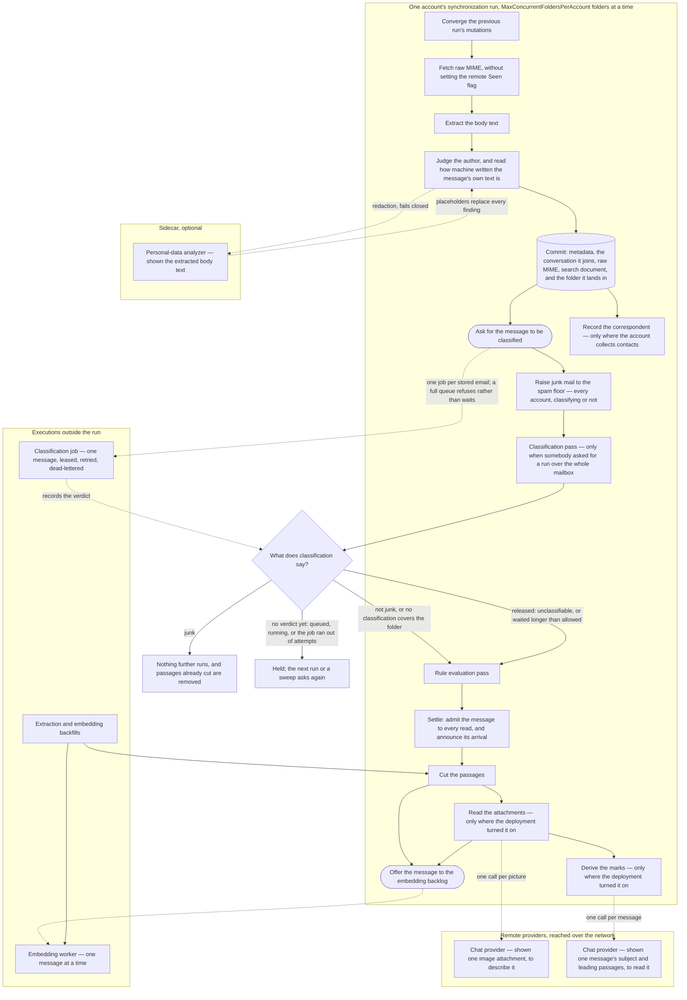

# The arrival pipeline

<!-- describes: backend/src/Application/Synchronization/MailboxSynchronizer.cs, backend/src/Application/Emails/Chunking/MailChunkingPass.cs, backend/src/Infrastructure/Persistence/Emails/StoredEmailChunkingStore.cs, backend/src/Application/Emails/Extraction/RedactingEmailMimeReader.cs, backend/src/Application/Emails/Extraction/SenderTrustEvaluatingEmailMimeReader.cs, backend/src/Application/Emails/Extraction/MachineAuthorshipEvaluatingEmailMimeReader.cs, backend/src/Application/Emails/Threads/EmailThreadAssembly.cs, backend/src/Application/Spam/Gating/**, backend/src/Application/Spam/Runs/SpamClassificationPass.cs, backend/src/Application/Spam/Floor/SpamVerdictFloorPass.cs, backend/src/Application/Spam/SpamClassificationArrivals.cs, backend/src/Application/Contacts/Collection/MailContactCollector.cs, backend/src/Application/Spam/EmailSpamClassificationHandler.cs, backend/src/Application/Rules/Evaluation/MailRuleEvaluationPass.cs, backend/src/Application/Emails/Settlement/**, backend/src/Infrastructure/Persistence/Emails/MailSettlementStore.cs, backend/src/Application/Emails/Enrichment/MailEnrichmentPass.cs, backend/src/Application/Emails/ThreadStates/ThreadStateDerivationPass.cs, backend/src/Host/Hosting/Workers/AccountSynchronizationSupervisor.cs, backend/src/Host/Hosting/Workers/MailEmbeddingWorker.cs -->

Nine features decide what happens to a message between the moment synchronization fetches it and the moment
everything derived from it exists. Each of them documents its own half, and none of them can state the order, because
the order is what they have between them. This page is that order, drawn once.

It is a graph rather than a list. A message branches at its classification verdict, and one stage — redaction — is a
call into a sidecar and a guard on the way into a derived store rather than a stage every message walks through. The
reason to draw it is that prose describing a graph is reconstructed wrongly, and the wrong reconstruction has one
shape: a new derived step placed on the wrong side of a gate.

## The order

**Two judgements sit between the parse and the commit.** Whether the author extraction established is one the
account recognizes, and how much the message's own text reads as machine written, are decisions this deployment makes
rather than facts read out of the message's bytes — so each is a decorator over the reader that parses raw MIME rather
than a step inside it, which is what puts them on every path that produces a reading rather than only on this one. Both
run *before* redaction, deliberately: redaction replaces the words a scanner recognized, and a reading taken afterwards
would judge a message partly by what the scanner rewrote in it. Neither carries any of the text out — what each writes
is a verdict, a set of signals, a number, and the revision of the policy or profile it was reached under, none of which
can hold a fragment of the message — so taking them ahead of the guard costs the guard nothing.

Classification happens in two places and the drawing separates them deliberately. **A message is classified because it
arrived**: the run asks for one as soon as it has committed the message and its content, and the work runs as an
execution of the durable queue — leased to one worker, retried per message with a jittered backoff, and dead-lettered
when it cannot succeed. That per-message backoff is the whole reason it is a job rather than another pass of the run: a
classification reads the message out of the content store, which can be unreachable or slow, and a run whose only
recovery is deferring the whole account cannot express one message out of three hundred deserving another attempt.

The pass inside the run is the second place, and it is the operator's:
[classifying the mail you already have](../features/spam-classification.md#classifying-the-mail-you-already-have) walks
a mailbox that was stored before any of this, or stored while the feature was off. Both reach the same use case and
record the same record; what differs is which mail they cover.

A step just before that pass is not classification at all: [the spam
floor](../features/spam-classification.md#junk-mail-is-never-below-spam) gives every message in the junk folder or
carrying `$Junk` at least a spam verdict, on every account whether or not it classifies, so the classification run, the
rules, and the cut after it meet such a message below spam only while a backlog larger than the step's per-run bound is
still being worked through, which the first run after an upgrade over a large junk folder is. That verdict outlives the placement: on an account
that classifies, a message the floor raised stays withheld after MailFathom moves it out of the junk folder, or the
person moves it out locally on a held account, until the person marks it not spam or a later classification that
reaches it decides otherwise.

Four things can become of one classification, and the gate below reads what was recorded rather than what happened to
the job. A verdict of junk withholds the message; a verdict of anything else admits it; a scan that could not answer
still records the verdict the headers reached, so the message is admitted or withheld on that; and a job that failed
every attempt records nothing at all, which leaves the message waiting until the bound below releases it. **No outcome
of the queue stops a mailbox being indexed** — that is what the bound is for.

## What the run waits for, and what it hands off

The run waits for everything inside it, and the order drawn is the order each message meets. What the drawing does not
say is how many messages are in it at once: the steps at the top and the bottom of the run happen once per run, while
the folders between them are walked by `MaxConcurrentFoldersPerAccount` at a time — one by default, and up to twenty, so
a deployment that raises it has several folders fetching, extracting, and committing side by side.
[Synchronizing a mailbox](../features/imap-synchronization.md) states that bound and what else it costs.

There are two hand-offs, both drawn as dashed arrows out of the run, and **neither of them is allowed to fail the pass
that produced it**. Offering a message to the embedding backlog is a non-blocking enqueue into a bounded in-process
queue, and a full backlog is not an error: an initial synchronization of a large mailbox produces work faster than any
provider accepts it, so the bound refuses rather than waits; the message is stored with its passages, and the
[embedding backfill](../features/embedding-backfill.md) is what reaches mail the live path did not.

Asking for a classification is the same shape against a durable queue rather than an in-process one. It is one insert
per stored message, made after the transaction that stored the message has committed — the queue takes no persistence
session by design, so there is no way to enqueue work whose subject may still roll back. A queue already holding as much
of that type as the deployment accepts refuses the row rather than growing, and the run does not read the answer: a
message nobody classifies is released by the wait a verdict is allowed, which is the property that keeps a classification
backlog a degraded signal instead of a stalled mailbox. A message stored without its content is not asked for at all,
because a message whose payload is not stored is reported unclassifiable rather than fetched.

**Contact collection is the third thing that happens after the commit, and it is neither a hand-off nor a stage the run
waits on the way it waits on a pass.** It runs inline, on the message the pass has just committed, and only where the
account [switched it on](../features/contacts.md#collecting-contacts-from-arriving-mail) — an account that did not pays
one property read per stored message. It reaches no mail server, no queue, and no worker: the headers it reads were
already read to store the message, so what it costs is a bounded number of indexed reads and, rarely, one insert. It is
drawn from the commit rather than from `ask` because the two are independent of each other, and nothing downstream reads
what it wrote: no gate consults it, and a failure in it would fail the folder rather than corrupt anything, which is why
it is the last thing the message's own pass does.

One step of the post-folder sequence belongs to no arrival at all, and is drawn nowhere above for that reason: before
the passes below it, the run delivers whatever the account's outbox still holds. It is here because the account is the
unit both halves are scheduled by, and it is deliberately the weakest link in the sequence — the drain never fails the
run, however it ends. A submission server is a different server from the mailbox server, so an outbound provider that
is down must not back an account's reading off, and a send that failed already carries how far it got on its own
record. [Mail delivery](../features/mail-delivery.md#how-a-written-down-send-reaches-a-server) is where that half is
described; nothing else on this page concerns it.

The last step of that sequence belongs to no arrival either, and is drawn nowhere above for the same reason: once the
passes have finished, the run tells every user the account is assigned to what happened to it — a credential was refused,
some folders did not finish. It is stated per run rather than per message, which is why it cannot sit on this page's
graph: what it reports is the run's own outcome rather than anything derived from one message. Arrival is not part of
it: that is said by the settlement, below, about each message as it settles. It is the weakest link in the sequence exactly as the drain is, and for
a stronger reason — a run whose whole point was to fetch mail must not be failed by the record saying it did.
[What a run tells the person whose mailbox it is](../features/imap-synchronization.md#what-a-run-tells-the-person-whose-mailbox-it-is)
describes it; nothing else on this page concerns it either.

Nothing else about the pipeline crosses a process boundary while a transaction is open. The sidecar call happens
outside the commit that follows it, so does the chat provider a picture is described by, and the embedding provider is
reached only by the worker, which consumes committed state. The chat provider is drawn apart from the sidecar because
it is not one: a sidecar is a process a deployment runs beside MailFathom, and this is a remote endpoint configured under
`Chat:` that mail content leaves the deployment to reach.

## A message is shown once it has settled

**Nothing reads a message the run has just stored until its spam verdict and its moving rules have placed it.** A row
is stored *settling*, and the settlement stage that follows the rule pass is what admits it: it writes the instant the
message settled, and every read a person or an agent makes — each listing, count, search, retrieval, thread, and read by
identifier, over the client endpoint and the MCP tools alike — admits settled mail alone, through the one selection
predicate they share and the one read by identifier. Without it a reader sees a message in the inbox and then sees it
vanish into junk or into the folder a rule filed it in, and is told about mail that was already somewhere else. What
keeps working on settling mail is everything MailFathom does on its own behalf rather than a reader's: erasure, export,
retention, the drain and the restore, reconciliation, the rule pass and classification themselves.

A message settles once every one of these holds, and the settlement reads each from what the stages before it already
recorded rather than asking them again:

| It waits for | Until | Why |
| --- | --- | --- |
| Its content | The payload is stored, or will never be because it is over the size limit | The sender's authentication — DKIM, SPF, DMARC, the trust this deployment grants — and the message's own signature are established when its content is read, so a message waiting for storage headroom would otherwise be shown as from an unverified sender and verified a run later |
| A spam verdict | The gate above admits or withholds it | A verdict may still file it into junk |
| The rules | The rule pass has evaluated it, or no rule ever will — junk, a tombstone, the person's own sent copy | A rule may still move it |
| A move a rule or a verdict asked for | The move has reached the stored row | So it is shown once, in the folder it ends up in |

Where a move is committed differs by custody phase, and the move's own record already says which, so the phase is never
read here. On a mirrored account the record carries the move to the server and the row reaches its destination when
synchronization observes the placement, so the message waits for that observation — the next run, which the verdict
and a rule that asked for a move each bring forward. A held account commits the move locally with no record, so nothing
is left to wait for once the rule pass has run. A restoring account commits locally before opening the record that
carries it to the source, and that record is marked as already committed, so it is not waited for either.

**Every wait is bounded.** A verdict is released on the classification's own terms, and anything else — a stalled rule
pass, a move that never reaches the row, content that never finds headroom — is released once the message has waited
the classification wait plus fifteen minutes. A late message is shown late rather than never, and each release is
counted on `mailfathom.mail.settlements` under the reason, so a stage that stalls shows up there rather than as mail
somebody is still waiting for.

**Settling is idempotent across replicas.** Two runs reaching the same message is the ordinary case, so the write is
one conditional statement that settles only rows still settling and returns the ones it settled — and only those are
signalled and announced. A message a competing replica settled first is neither signalled nor announced a second time.
Each batch the settlement walks is announced as soon as it is settled, so a walk that fails or is cancelled between
batches leaves no batch it already settled unannounced. The announcement itself is not durable: the settlement commits
first and a settled message is never read again, so a failure or a cancellation inside the announcement of the batch
just settled — after its `mail.arrived` signal, while the notification is being raised — leaves that batch shown
without a notification. The run logs the failure, and the mail is in the folder as it would have been. Three messages are stored already settled, because none has anything to
wait for or is news: the copy MailFathom filed of the person's own outgoing message, a copy a rule made of a message
already shown, and a message stored again because a delete the person asked for was undone on the server. So is
everything a held account files locally, which no synchronization stores.

What it hands a client and the person is said on settlement rather than on the commit: `mail.arrived` carries how many
messages one run settled, and the arrival notification is raised for those of them
[the person is told about](../features/imap-synchronization.md#what-a-run-tells-the-person-whose-mailbox-it-is).

## The sidecar fails closed, and classification fails open

The personal-data analyzer is optional, and a deployment that configures none runs the whole pipeline unchanged.

| Stage | What it reads | What its silence does |
| --- | --- | --- |
| Personal-data analyzer | The extracted body text of one message, shown to the sidecar | **Fails closed.** The derivation is refused, nothing derived is written, and the run retries the message later |
| Spam classification | The stored header block of one message, read locally | **Fails open.** A message no verdict has reached is held only as long as `SpamClassification:ClassificationWait` allows, and then admitted on the same terms as one nothing has looked at |

The asymmetry is deliberate and it is the single most important thing on this page. Redaction is an egress guard: text
that reached a derived store unscanned is text a retrieval hit can hand back months later, and putting it back costs a
re-derivation from raw MIME. Classification is an opinion about a message: a classification that stalled or fell behind
must not be able to stop a mailbox from being indexed, which is why every path releases mail that has waited too long.

Redaction covers the body and only the body; a subject, an address, and a thread identifier are routing metadata, and
what protects those on the way out is the [egress guard](../features/sensitive-content-scanning.md) rather than the
derived store. Classification reads none of the body, so redaction has nothing to hide from it.

## What each classification outcome permits

The gate reads where the message is now and what was decided about it, and it writes nothing down. What was decided
includes the verdict the spam floor gives mail in the junk folder, so on an account that classifies, a message MailFathom
moves out of junk, or one the person moves out locally on a held account, keeps its row and is withheld on that verdict
rather than admitted the moment it leaves. A drag in another client on a mirrored account arrives as a new occurrence
with no classification of its own and is decided afresh, and an account that classifies nothing admits its mail
whatever it carries.

| Outcome | Rules | Passages | Vectors |
| --- | --- | --- | --- |
| Junk — a verdict, or the message is in the account's junk folder | No | No, and any already cut are removed | No |
| Not junk, or the folder is outside that account's scope | Yes | Yes | Yes |
| No verdict yet — the job is queued, running, or ran out of attempts without recording one | No, held | No, held | No, held |
| Released — the message carries nothing classifiable, or it waited longer than allowed | Yes | Yes | Yes |
| The message's account classifies nothing | Yes | Yes | Yes |

**The gate is read per account, and the last row is what that buys.** Classification is
[each account's decision about the mail in it](../features/spam-classification.md#each-account-decides-this-for-the-mail-in-it),
so the terms a walk is decided under name the accounts that classify rather than a single deployment-wide switch. An
account that classifies nothing has every one of its messages admitted at once — its junk folder included, because
withholding it is an ordering behind a verdict rather than a rule of its own — while another account's mail in the same
walk goes on waiting on its own.

A held message is held rather than dropped. The same four facts are read again by the next account run and by both
sweeps, so a verdict that arrives late, a wait that runs out, and a message with no spam verdict moved out of the junk
folder — one carrying the person's not spam, say — all admit it without any stored state having to say it was once
withheld. What the outcome does reach is a counter: the run records
the gate's answer as each message arrives, because work that never starts leaves no other trace and a mailbox held
behind classification would otherwise read exactly like a mailbox with no mail in it.

## Why enrichment is the last stage a message goes through

A mark cites passages, so a message enriched before it was cut would have nothing to rest its evidence on — that alone
puts it behind the cut. It is behind the attachment reading for a harder reason than it looks: a derivation is taken
once and never revisited, so a message derived from while half of its passages are still to be cut is recorded, for
good, as a reading of the half that existed. A quotation somebody attached to two lines of covering text is exactly
that case.

**Being third in the supervisor's sequence does not establish that ordering**, which is why the selection states it as
a condition of its own. Each of the three passes walks its own queue from its own front, so neither of the first two
bounds the other's batch: the attachment reading does not wait for a message's body to be cut, and the cut does not
wait for its attachments to be read. A message can therefore carry an attachment's passages while its body is uncut, or
its body's while an attachment it names is unread, and both are outside this pass until the stage they are waiting for
has finished with them. Where a deployment reads no attachments the second half of that condition is satisfied outright
rather than waited on, because a reading that will never happen would hold every message carrying an attachment here
for ever.
The ordering costs nothing beyond the wait: a message enrichment did not reach is simply outstanding for the next run.

**The tasks a message asks for are written after that statement rather than inside it**, which is the one place this
pass's two proposals behave differently. A calendar proposal joins the enrichment record's own commit, because an
event nobody was offered is an event nobody will ever be offered. A task is written through the task store, which
opens a session of its own by design: a list somebody owns is not part of the transaction that records having read
their mail, and a suggestion that failed must not fail mail already committed. What that costs is a crash between the
two, which loses a suggestion rather than proposing one twice — the opposite order would offer the same work again on
the next run, since what takes a message out of the selection is the derivation being recorded. [Tasks read out of
mail](../features/tasks-from-mail.md) is what a proposal is and what happens to it afterwards.

**Nothing re-derives a message this pass settled.** Being derived from is what takes a message out of the pass's own
selection, which is what makes an interrupted pass repeat nothing and skip nothing — and it is also the whole of how a
mailbox stored before the switch was turned on is backfilled: successive runs drain it, sixty-four messages at a time, and
each says how far it got. No sweep exists beside it, unlike the cut and the vectors, because nothing here can be made
stale by a rebuild: what a mark rests on is a passage identifier, and a passage a re-cut replaced resolves to nothing
rather than to the wrong text.

A pass ends early rather than walking the batch whenever a derivation is withheld, because every reason one is withheld
— an operator who has not turned it on, a spent period allowance, an unreachable provider — outlives one message and
would be met again by the next.

**A second reading of the same message rides in this pass**, where an operator turned it on: the calendar events the
message names are read out of it and staged as proposals in the same commit that writes the derivation, so a message
is never recorded as derived while the dates it named were lost. It is in this pass rather than in one of its own for
the reason it is one judgement about a message the pass already holds, guarded and cut; a withheld reading ends the
pass exactly as a withheld derivation does, for the same reason.
[Reading a calendar event out of text](../features/calendar-event-extraction.md) describes what it keeps and refuses.

**One pass runs behind it, and its subject is a correspondence rather than a message.** Deriving
[where a conversation stands](../features/thread-state.md) reads the messages an exchange holds, so it goes last for
the reason enrichment goes last among the message stages: a conversation whose newest message is still being relocated,
tombstoned, or evaluated is one whose state would be derived over a shape about to change. It selects by the shape of
the conversation rather than by a message never derived from, which is why a message arriving into a settled exchange
puts that exchange back in the queue and nothing else does.

## Why the cut is not part of the commit

The transaction that stores a message contains its metadata, the two judgements above, the conversation its own
identifiers place it in, its raw MIME, and its search document — and deliberately not its passages. Two stages run after
that commit and before the cut, and both can change what the cut should produce: classification can decide the message
is not derived from at all, and the user's rules can file it into a folder mapped differently from the one it arrived
in. Passages are not undone by a message moving afterwards, so cutting inside the commit would write passages of a
placement and a verdict that had not been settled yet.

**The conversation is inside the commit for the opposite reason.** It is decided from the message's own identifiers and
from nothing a later stage can change, and it is recorded as a relation other rows share rather than as a column — so
committing it with the columns it was decided from is what keeps a message from ever being readable while belonging to
nothing.

The rules are the slower of the two, because a rule declares a move rather than performing one: the record is durable
when the pass ends and the account's **next** run carries it to the mail server. So waiting for the pass is not enough
on its own, and the cut passes over a message whose relocation is still converging — cutting it once the message is in
the folder it ended up in, under that folder's mapping. A relocation that completed or was abandoned holds nothing
back, since neither will move the message again.

What the ordering costs is one extra local transaction per message and nothing else: the cut reads the search document
the commit already wrote, so it reaches no mail server, no provider, and no sidecar. What it removes is a whole class of
defect that is invisible when it happens.

## Why reading attachments comes last

Reading attachments is the run's fifth local stage and its last, and where it sits is the whole of what makes it safe.
It is the only stage that parses octets a stranger composed, and the only one that may reach an AI provider inside the
run — so a message reaches lexical and semantic retrieval on its **own** words first, in the stage before, and gains
its attachments' words when they arrive. A body passage the cut produced is untouched by anything here: its digest, its
ordinal, and its vector all stay exactly as they were, which is what stops attachments from re-billing a mailbox that
was already embedded.

It inherits the cut's own selection rather than judging anything again. The message has to be local, the rules have to
have finished with it and not still be moving it, its folder has to be one an operator mapped to embed, and the
classification gate has to admit it — so an attachment on a withheld message is excluded by the rule the pipeline
already has, never by a second evaluation. Two conditions are its own: the message has to carry an attachment at all,
and nothing may have read them yet.

**Nothing is derived inside a transaction.** One message is read whole first — the content store, the document parsers,
and where a picture is involved a chat provider — and only then is one statement committed carrying the readings, the
passages cut from them, and the stamp that takes the message out of the selection. A crash between the two leaves the
message exactly as it was, and the next run repeats the reading rather than half of it.

Three ceilings bound it, and they are nested: what one attachment may cost to read is at most what its message may, and
what a message may is at most what its account run may. A run that spends its budget stops where it is and writes
nothing for the message it was holding, so the next run — which starts with a full budget — reaches that message first.
The ordering is refused at startup rather than discovered as a message no run can ever afford.

## The paths that re-derive the same data

Three paths produce derived data, and all three obey the order above rather than a version of it. Two of them wait for
the record that the rule pass has finished with a message. There are two ways to be finished with one, and both count:
a pass evaluated the message and stamped it, or the message is a copy MailFathom filed of this deployment's own
outgoing mail, which no pass will ever evaluate and which is therefore never stamped. A draft a held account files into
its local drafts folder counts as the first kind: nothing arrived, so it is stamped in the transaction that stores it.
So does the second stored message a copy on a held account produces, for a reason of its own: a rule copying into a
folder it also matches on must not meet its own copy. Reading the stamp alone would
leave every such message uncut and unembedded for the life of the deployment — invisible until somebody asks a question
about mail they sent and is answered from everything except it. That record is written by an account run's rule pass and once
besides, by the migration that added the column, which stamped every message the previous version had already stored —
so a deployment running with `MailSynchronization:Enabled` set to `false` does cut and embed the mail it upgraded with,
and what the stamp holds back there is mail an account run stored and no rule pass reached. Only a *first* cut waits on
it at all, so a rebuild is outside it in either case: the extraction backfill runs whether or not synchronization does,
and with `SensitiveContent:RebuildStaleDerivedData` switched on it replaces the passages a message already carries —
and, through them, the vectors the replacement cascades away.

- **The live path** is the run drawn here.
- **The extraction backfill** re-reads raw MIME stored before extraction existed. It redacts through the same guard,
  writes the same search document, and cuts through the same writer, so a message it reaches arrives at the state a
  newly synchronized one reaches rather than at a state a second walk has to finish. It cuts only what both stages in
  front of the cut have finished with, which is what keeps *the same state* true: the text it has just written is
  exactly what lets the rule pass read a message it had been skipping, and cutting in this transaction would cut before
  that pass ever saw it. Such a message is cut by the account's next run instead. Both stages are waited for a *first*
  cut alone, so a message that already carries passages is re-cut whatever they say: this walk is the only path that
  can replace a passage, and withholding one here would leave the passages — and the vectors built from them — derived
  under exactly the configuration a rebuild exists to replace, beside stored text reporting the new one. What a rebuild
  does to a message's attachments is different in one respect: it discards the readings taken under an older posture,
  removes the passages cut from them, and clears the reading marker rather than parsing anything itself, so the words are
  taken again by the attachment stage above, under that run's octet budget and whichever image provider the deployment
  still has.
- **The embedding backfill** sweeps for messages with extracted text and no passages, and for passages with no vector.
  It cuts through the same writer and is narrowed by the same classification predicate, the same rule stamp, the same
  reading of a relocation still converging, and the same folder switch, so it reaches whatever one account run's batch
  budget did not. The rule stamp is what stops it
  being a way around the order: it runs on its own interval while a run is still fetching a mailbox, so a first
  synchronization would otherwise have its mail cut here before the rules had read any of it. A held message needs no
  sweep to be released either: the account's own next run asks the gate again and cuts it in the same run the verdict
  admits it.

**A fourth path re-reads stored mail and produces none of that.** `mfctl mailbox rederive` asks for stored messages to
be walked as background work, reading each one's raw MIME back through the same reader the run uses, so the parse, both
judgements, and redaction reach it exactly as they reach an arriving message; what it writes is the row's own columns
and the conversation the message belongs to. It cuts no passages, embeds nothing, opens no mailbox session, and never
reaches the classification gate, so it is the cheap way to fill in a column a later release added rather than a fourth
way to derive from mail. State only a
mailbox holds — flags, keywords, the internal date — is outside it, because nothing local can produce that. [Bringing
stored mail up to a later release](../features/imap-synchronization.md#bringing-stored-mail-up-to-a-later-release)
states its bounds and what it leaves behind.

## What the two folder switches decide

`GenerateEmbeddings` and `VisibleToAI` are set per folder mapping;
[what a mapping decides beyond where the folder is](../features/imap-synchronization.md#what-a-mapping-decides-beyond-where-the-folder-is)
states both. What they decide about this pipeline is the cut:

| `GenerateEmbeddings` | `VisibleToAI` | Passages |
| --- | --- | --- |
| `true` | `true` | Cut |
| `true` | `false` | Refused when the configuration binds — an embedding is computed by a provider a folder withheld from AI never reaches |
| unset | `false` | Not cut; leaving `GenerateEmbeddings` out beside `VisibleToAI: false` means no embeddings, so no model or embedding provider derives anything from the folder |
| `false` | `true` | Not cut; the folder is still mirrored, listed, read, and searched lexically |
| `false` | `false` | Not cut; the person still lists, reads, and searches the folder lexically in the client |

Extraction runs for every mirrored folder whatever the switches say, because the extracted text is what a lexical search
matches on and what a read hands back. Redaction therefore runs for every mirrored folder too, on every deployment that
has a scanner switched on.

## Where each stage is documented

| Stage | Page |
| --- | --- |
| Fetching and committing a message | [IMAP synchronization](../features/imap-synchronization.md) |
| Whether the displayed author authenticated, and whether the account recognizes them | [Sender authentication](../features/sender-authentication.md) |
| How machine written a message's own text reads | [Machine authorship](../features/machine-authorship.md) |
| The conversation a message is placed in | [The stored email](stored-email-schema.md#the-conversation-a-message-belongs-to) |
| Classification, its verdicts, and the gate | [Spam classification](../features/spam-classification.md) |
| Recording the people an account corresponds with | [Contacts](../features/contacts.md#collecting-contacts-from-arriving-mail) |
| The user's rules and what a match asks for | [Mail rules](../features/mail-rules.md) |
| When a message settles, and what a read admits | [A message is shown once it has settled](#a-message-is-shown-once-it-has-settled) |
| Redaction, the stamp, and the egress guard | [Sensitive-content scanning](../features/sensitive-content-scanning.md) |
| The boundary rules a cut obeys, and what a passage of an attachment carries | [Message chunks](../features/message-chunks.md) |
| What a document attachment is read with, and what a read reports | [Attachment text extraction](../features/attachment-text-extraction.md) |
| What a message is about, why it may matter, and what backs each mark | [Message enrichment](../features/message-enrichment.md) |
| Which occasions a message names, and why a deadline is not one | [Reading a calendar event out of text](../features/calendar-event-extraction.md) |
| What a message asks its reader to do, offered as a task | [Tasks read out of mail](../features/tasks-from-mail.md) |
| What a correspondence settled, left open, and undertook | [A conversation's state](../features/thread-state.md) |
| Offering, embedding, and what a ceiling does | [Automatic embedding](../features/automatic-embedding.md) |
| Reaching mail the live path missed | [Embedding backfill](../features/embedding-backfill.md) |
